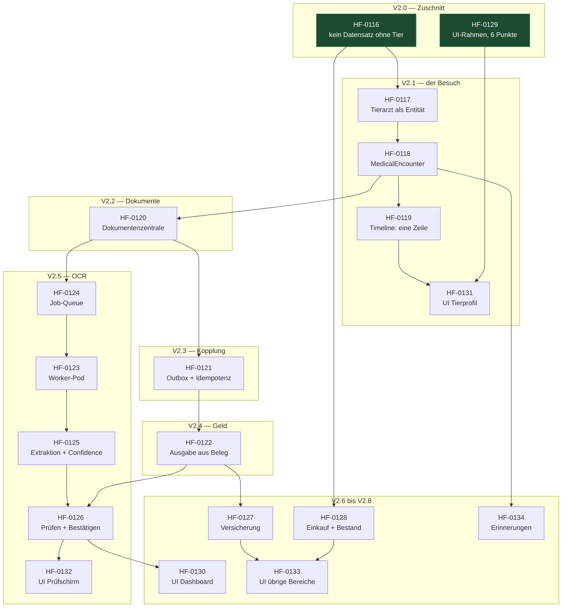

# HomeFlow v2: what depends on what

Reading aid for epic HF-0114. An arrow means **"needs"** — the target cannot
start before the source is done.

The same graph exists as a comment on HF-0114; this file is the version that
survives the ticket board.

Ohne Mermaid-Darstellung, dieselbe Aussage:

    HF-0116 Zuschnitt ────┬─► HF-0117 Tierarzt ──► HF-0118 Encounter ──► HF-0119 Timeline
                          │                              │                      │
    HF-0129 UI-Rahmen ────┴──────────────────────────────┼──────────────► HF-0131 UI Tier
                                                         │
                                                         ├─► HF-0134 Erinnerungen
                                                         │
                                                         └─► HF-0120 Dokumente
                                                                  │
                                          ┌───────────────────────┴───────────┐
                                          ▼                                   ▼
                                    HF-0121 Outbox                      HF-0124 Queue
                                          │                                   │
                                          ▼                                   ▼
                                    HF-0122 Ausgaben ──┬──────────────► HF-0123 Worker
                                          │            │                      │
                                          │            └─► HF-0127 Versicherung│
                                          │                        │          ▼
                                          │                        │   HF-0125 Extraktion
                                          │                        │          │
                                          │                        │          ▼
                                          │                        │   HF-0126 Bestätigen
                                          │                        │       │      │
                                          │                        ▼       ▼      ▼
    HF-0116 ─────────────────────► HF-0128 Einkauf ──────► HF-0133 UI  HF-0130 UI  HF-0132 UI

## Green means startable

**HF-0116** and **HF-0129** depend on nothing, touch no shared path
(`backend/internal/{expenses,calendar,shopping}` against `frontend/src/`) and can
run in parallel. Everything else waits on one of them.

## The two gates are open

Both were Marco's to decide and both were approved on 2026-09-01:

- **HF-0120** — the interface change `/api/v1/receipts` → `/api/v1/documents`,
  recorded in `../architecture/contracts.md` section 1.1.
- **HF-0123** — 256 MiB for the OCR worker, recorded in section 2.1. Requests
  rise from 672 to 768 MiB of 3444 MiB allocatable.

## Where the graph will bite

Path claims overlap, because a module gets touched more than once:

| Path | Tickets |
| --- | --- |
| `backend/internal/pets/` | HF-0117, 0118, 0119, 0128, 0134 |
| `backend/internal/expenses/` | HF-0116, 0122 |
| `backend/internal/shopping/` | HF-0116, 0128 |
| `frontend/src/` | HF-0129, 0130, 0131, 0132, 0133 |

That is not a planning error, it is what a modular monolith looks like when a
release series walks through it. The rule is **one at a time, not in parallel**,
and Mission Control's repository view reports the collision the moment two of
them sit in "In Bearbeitung". That view exists for exactly this.

The frontend row is the sharpest one: five tickets on one directory. They are
strictly sequential, and HF-0129 has to be finished before any of the other
four starts — it decides the file layout they all build in.
